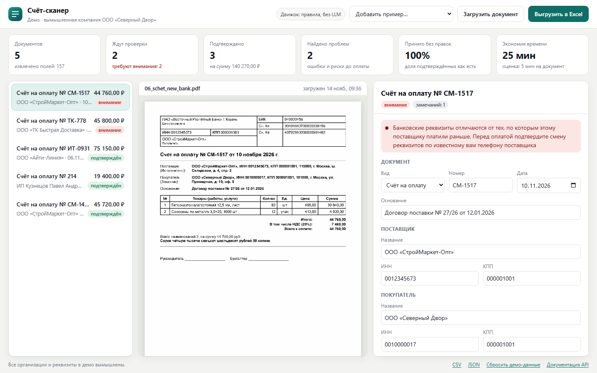
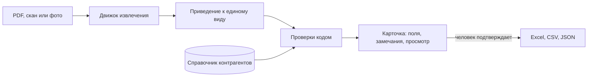

# Счёт-сканер

Извлечение данных из счетов и актов поставщиков. Система читает документ, заполняет карточку
(реквизиты, позиции, суммы), проверяет контрольные суммы и арифметику, предупреждает о дублях
и подменённых реквизитах и выгружает подтверждённые документы в Excel.

> Демо-проект. Все организации и реквизиты вымышлены: ИНН начинаются с «00» (такого кода
> региона нет) и не могут принадлежать настоящим компаниям.



## Какую задачу решает

Бухгалтер или офис-менеджер перебивает счёт в учётную систему вручную: ИНН, счёт на 20 цифр,
строки, суммы. На документ уходит несколько минут, а одна неверная цифра в расчётном счёте
означает платёж не тому получателю.

| Было | Стало |
|---|---|
| Реквизиты и строки вводятся руками | Поля заполняются автоматически, человек только проверяет |
| Опечатку в ИНН или счёте замечают после возврата платежа | Контрольные разряды ИНН и счёта проверяются сразу |
| Ошибку в итоге находят при сверке | Сумма строк, итог и НДС сверяются автоматически |
| Письмо «у нас сменились реквизиты» принимают на веру | Расхождение со справочником контрагентов блокирует документ |
| Один счёт оплачивают дважды | Дубль по номеру, дате и поставщику подсвечивается |

## Как это работает



1. **Движок извлечения** возвращает данные строго по схеме (`app/schemas.py`). Движков два:
   - `claude` — документ целиком отправляется в Claude: текстовые PDF, сканы и фотографии.
     Ответ приходит через structured outputs и всегда соответствует схеме;
   - `rules` — разбор текстового слоя PDF регулярными выражениями и по таблицам. Работает без
     интернета, но только на знакомых макетах; сканы ему недоступны.
2. **Проверки** (`app/validation.py`, `app/requisites.py`) выполняются обычным кодом и одинаковы
   для обоих движков:
   - контрольные цифры ИНН (10 и 12 знаков), формат КПП и БИК;
   - контрольный ключ расчётного и корреспондентского счёта в паре с БИК;
   - количество × цена = сумма по каждой строке, сумма строк = итог, НДС соответствует ставке
     (учитываются оба варианта: НДС в цене и НДС сверху);
   - сверка банковских реквизитов со справочником контрагентов;
   - поиск дублей, дата в будущем, чужой ИНН покупателя.
3. **Модель не исправляет документ.** В промпте прямо сказано переписывать напечатанное, даже
   если в нём ошибка. Иначе арифметическая проверка не найдёт то, что должна найти.
4. **Человек в контуре.** Документ попадает в выгрузку только после подтверждения. Поля с
   замечаниями подсвечены, правки оператора учитываются в статистике.

## Что можно показать на демо

- счёт от знакомого поставщика проходит без единого замечания;
- счёт с ошибкой в итоге: система называет обе суммы и разницу;
- счёт с опечаткой в ИНН: поле подсвечено, причина объяснена;
- счёт знакомого поставщика с новыми банковскими реквизитами: предупреждение о возможном
  мошенничестве со сменой реквизитов;
- повторно присланный счёт: предупреждение о дубле;
- правка поля и повторная проверка, подтверждение, выгрузка в Excel на два листа
  («Документы» и «Позиции»).

## Быстрый старт

Нужен Python 3.10+.

```bash
pip install -r requirements.txt
python run.py
```

Откройте http://127.0.0.1:8102. Без ключа API демо работает на движке правил.

Чтобы документы читал Claude, скопируйте `.env.example` в `.env`, впишите `ANTHROPIC_API_KEY`
и перезапустите. После этого можно загружать сканы и фотографии.

| Команда | Что делает |
|---|---|
| `python run.py --reset` | пересоздаёт демо-данные |
| `python -m pytest` | запускает тесты |
| `python scripts/evaluate.py` | измеряет качество движка правил |
| `python scripts/evaluate.py --engine claude` | измеряет качество Claude (11 платных запросов) |
| `python scripts/make_samples.py` | заново печатает примеры (нужен Chrome или Edge) |

## Измеренное качество

Эталон — данные, из которых генератор печатал PDF. `dev` — 8 документов в трёх макетах, под
которые писались правила. `holdout` — 3 документа в двух макетах, которых правила «не видели»:
счёт без рамок с нестандартными подписями и счёт-договор с реквизитами внизу.

Движок правил (`python scripts/evaluate.py`), доля верно извлечённых полей:

| Группа полей | dev (8 документов) | holdout (3 документа) |
|---|---|---|
| Шапка: вид, номер, дата, основание | 100% | 67% |
| Стороны: название, ИНН, КПП | 100% | 94% |
| Банк: название, БИК, счета | 100% | 83% |
| Итоги: сумма, ставка и сумма НДС | 100% | 22% |
| Строки табличной части | 100% | 27% |
| **Все поля** | **100%** (246 из 246) | **51%** (49 из 96) |

Вывод: на знакомых макетах шаблонный разбор безошибочен и бесплатен, но каждый новый макет
поставщика требует доработки правил. Незнакомые макеты, сканы и фотографии — работа для LLM.

Качество Claude в этом репозитории не зафиксировано: его нужно измерить на своём ключе командой
выше. Скрипт покажет точность по тем же группам полей, время и стоимость прогона.

## Форматы и интеграции

- Приём документов: `POST /api/documents` (multipart). К этому методу подключается почтовый
  робот, который пересылает вложения, или папка обмена.
- Выгрузка: `/api/export.xlsx`, `/api/export.csv`, `/api/export.json`. Табличные файлы
  загружаются в учётные системы через импорт из табличного документа.
- ИНН и счета выгружаются текстом, чтобы не терялись ведущие нули.
- Текст из документа, который начинается с `=`, `+`, `-` или `@`, экранируется: формула из
  названия товара не выполнится при открытии файла в Excel.

Прямой обмен с конкретной учётной системой в демо не реализован: он зависит от конфигурации
клиента и делается под проект.

## Настройка под компанию

| Что меняется | Где |
|---|---|
| Наша организация (покупатель) | `data/company.json` |
| Справочник поставщиков и их проверенных реквизитов | `data/counterparties.json` |
| Набор полей документа | `app/schemas.py` |
| Правила и допуски проверок | `app/validation.py` |
| Инструкции для модели | `app/engines/claude.py`, функция `build_system_prompt` |
| Шаблоны разбора для частых макетов | `app/engines/rules.py` |

## Устройство проекта

```
app/
  engines/claude.py   документ → Claude → данные по схеме
  engines/rules.py    разбор текстового слоя PDF без LLM
  requisites.py       контрольные суммы ИНН и счетов
  validation.py       арифметика, контрагент, дубли
  service.py          загрузка, правка, подтверждение, статистика
  export.py           Excel, CSV
  pdfio.py            чтение PDF и картинка для просмотра
  db.py               SQLite
  main.py             HTTP API
  static/             интерфейс (без сборки и фреймворков)
samples/              11 примеров PDF и эталон expected.json
scripts/              генератор примеров и оценка качества
tests/                46 тестов
```

## Стоимость и надёжность

- По умолчанию используется `claude-opus-5-5` с `effort=medium`; модель и глубина рассуждений
  задаются в `.env`. Более дешёвые модели стоит сравнить на своих документах скриптом оценки.
- Включён серверный fallback для моделей, которые его поддерживают: если классификатор
  безопасности отклонит запрос, API повторит его на запасной модели в том же вызове.
- Если API недоступно, текстовый PDF разбирают правила, а в карточке остаётся пометка.
- Тест `test_llm_digit_error_is_caught_by_checks` показывает главный принцип: если модель
  ошибётся в одной цифре счёта, документ не получит статус «готов».

## Ограничения демо

- В просмотре показывается первая страница документа; данные извлекаются со всех страниц.
- Нет авторизации и разделения ролей.
- Движок правил рассчитан на три макета; сканы и фотографии требуют режима Claude.
- Проверка контрагента работает по локальному справочнику, без запросов во внешние реестры.
- Документы уходят во внешнее API. Для договоров и документов с персональными данными это
  нужно согласовать с политикой компании.
